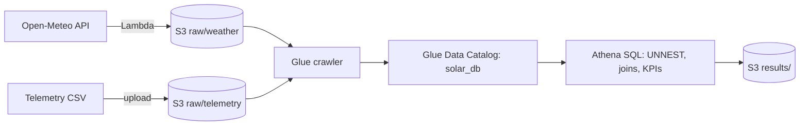

# Solar Performance & Weather Analytics Pipeline

How much energy does a solar installation in a hot climate lose to heat? This project joins daily
inverter telemetry with hourly weather data in a small AWS data lake and measures how
temperature, cloud cover and radiation drive conversion efficiency.

**Stack:** AWS Lambda (Python), S3, AWS Glue (crawler, Data Catalog), Amazon Athena (SQL), Open-Meteo API

## Context

The installation is in Kerala, India. In tropical climates sunlight is abundant, but high panel
temperatures reduce photovoltaic efficiency, so the sunniest days are not always the most
efficient ones (the "efficiency paradox"). The analysis is aimed at:

- **Operations managers:** monitoring monthly production against target
- **Maintenance teams:** spotting heat-induced performance loss
- **Investors:** sizing the return on cooling upgrades

## Data

| Table | Source | Content |
|---|---|---|
| `telemetry` | Kaggle solar plant dataset (CSV) | Daily total energy yield |
| `weather` | [Open-Meteo Historical Weather API](https://open-meteo.com/) (JSON) | Hourly temperature, cloud cover and shortwave radiation for 2023 at the plant's coordinates |

## Architecture



S3 layout: `raw/telemetry/`, `raw/weather/` and `results/`.


## Ingestion

A Lambda function downloads the 2023 hourly weather for the plant's location and writes the raw
JSON to S3:

```python
import json
import boto3
import urllib3

def lambda_handler(event, context):
    http = urllib3.PoolManager()
    url = (
        "https://archive-api.open-meteo.com/v1/archive?"
        "latitude=10.85&longitude=76.27&"
        "start_date=2023-01-01&end_date=2023-12-31&"
        "hourly=temperature_2m,cloud_cover,shortwave_radiation"
    )
    try:
        response = http.request("GET", url)
        data = json.loads(response.data.decode("utf-8"))
        boto3.client("s3").put_object(
            Bucket="<your-bucket>",
            Key="raw/weather/kerala_weather_2023.json",
            Body=json.dumps(data).encode("utf-8"),
        )
        return {"statusCode": 200, "body": "2023 weather data saved to S3"}
    except Exception as e:
        return {"statusCode": 500, "body": str(e)}
```

A Glue crawler then scans `raw/`, infers the CSV and JSON schemas and registers both as tables in
the `solar_db` catalog, so the bucket can be queried like a database.


## Joining nested weather data

The weather API returns parallel hourly arrays, so the first query uses `CROSS JOIN UNNEST` to
flatten them and joins the noon snapshot to each day's production.


## KPIs

**1. Daily conversion efficiency:** daily yield divided by total daily radiation, showing how much
of the available sunlight was captured each day.


**2. Weather-based benchmarking:** days grouped by average cloud cover, comparing yield and efficiency.


**3. Monthly health score:** actual yield divided by expected yield (total radiation x 0.137). The
13.7% baseline is the efficiency observed on cool, overcast days, so every month is compared
against the plant's best-case conversion.


**4. Peak heat impact:** conditions at solar noon against total daily output.


## Findings

| Weather condition | Days | Avg daily yield | Efficiency index |
|---|---:|---:|---:|
| Optimal (clear, under 20% cloud) | 36 | 620.4 | 0.096 |
| Fair (partly cloudy, 20-60%) | 68 | 617.1 | 0.101 |
| Poor (overcast, over 60%) | 261 | 606.8 | 0.137 |

Clear days produce only about 2% more energy than overcast days, even though they receive far
more radiation: the conversion efficiency on clear, hot days is roughly 30% lower. This is the
efficiency paradox in the data, and the reason the health score uses the overcast-day efficiency
as its baseline.

---

Generative AI (Gemini) was used as a thought partner for documentation and SQL optimisation.
